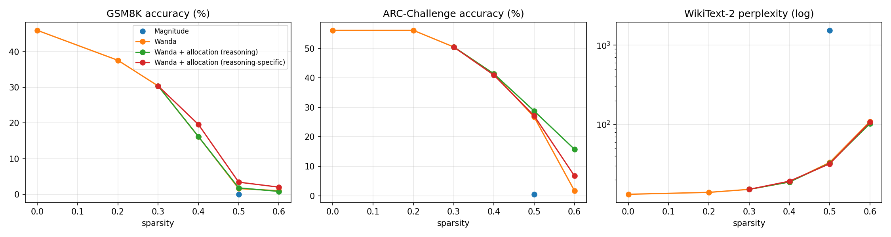
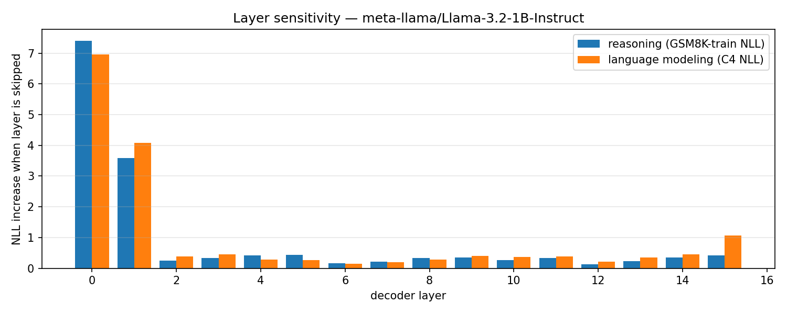

# Reasoning-Aware Pruning of LLMs (Without Fine-Tuning)

One-shot pruning of Llama-3.2-1B-Instruct. Measures how much each transformer layer matters for multi-step reasoning versus general language modeling, then uses that to decide **where** to prune: reasoning-critical layers are pruned less, others more, at the same overall sparsity. Compared against magnitude pruning and Wanda.

> **Status:** results complete for 20–60% sparsity (below). Next: safety-behavior evaluation under pruning.

## Background
Originally a team project for NC State's Deep Learning Beyond Accuracy course (Spring 2026). Team: Jai Pavan Ramani, Shivang Nitinkumar Patel, Arnav Yennam.
This repository is my independent rebuild. The original course code is kept unchanged in `original/` for reference.

### What changed from the course version
| Issue in the original | Fix here |
|---|---|
| Wanda calibrated on WikiText-2 *test*, the same split used for perplexity | Calibration on **C4 train** (128 × 2048 tokens), as in the Wanda paper |
| Weights ranked across the whole matrix | **Per-output-row** comparison groups, and layers pruned **sequentially** (each layer calibrated on outputs of already-pruned layers), matching the reference implementation |
| GSM8K scored by checking whether the answer string appears anywhere in the output | **lm-evaluation-harness**: 8-shot CoT `gsm8k_cot_llama` (strict + flexible match) and `arc_challenge_chat`, with standard errors |
| Perplexity on the first 50 lines of WikiText-2 | **Full WikiText-2 test split**, 2048-token windows |
| Layer sensitivity measured on the same GSM8K test questions used for evaluation | Sensitivity on **GSM8K train** and **C4 train** only; test sets are never touched before evaluation |
| Perturbation multiplied the whole hidden state (including the residual stream) | Scale only each layer's **residual contribution**: `h_in + α·(h_out − h_in)` |
| Base model with near-floor GSM8K accuracy | **Instruct** model in its official chat eval format, leaving room to measure degradation |

## Method
1. **Layer sensitivity.** Skip each decoder layer (α = 0) and record the increase in NLL of gold GSM8K-train solutions (reasoning) and of C4 text (language modeling).
2. **Sparsity allocation.** Rank layers by reasoning sensitivity (`--score reasoning`) or by reasoning-minus-LM sensitivity (`--score specific`). Assign per-layer sparsity `S − δ·z`, where `z ∈ [−1, 1]` is the rank, so the mean stays exactly `S`.
3. **Prune** with Wanda using the per-layer sparsities.
4. **Choose δ** from {0, 0.05, 0.10, 0.15} by reasoning NLL on a *separate* GSM8K-train subset. δ = 0 is plain Wanda, so the method can fall back to it.

## Experiments
| Method | Sparsity |
|---|---|
| Dense | – |
| Magnitude | 50% |
| Wanda | 20%, 30%, 40%, 50%, 60%, 2:4 |
| Wanda + sensitivity allocation (reasoning, reasoning-specific) | 30%, 40%, 50%, 60% |

GSM8K uses the first 500 test questions (same subset for every method, so comparisons are paired); ARC-Challenge uses the full test set.

## Running
```bash
pip install -r requirements.txt
huggingface-cli login          # account must have accepted the Llama 3.2 license
bash run_all.sh                # full grid, resumable; ~3 h on a T4
python -m src.summarize        # results/results.md + plots
python -m pytest tests -q      # logic tests on a tiny random Llama (no downloads)
```
Single runs: `python -m src.run --method wanda --sparsity 0.5`. On Colab, use `notebooks/run_experiments.ipynb` (saves results to Google Drive as it goes).

Note: unstructured sparsity reduces parameters but not latency on standard GPUs; 2:4 sparsity can be accelerated on Ampere-or-newer GPUs (not the T4 used here), so only its quality is reported.

## Results (Llama-3.2-1B-Instruct)
GSM8K: 8-shot CoT, first 500 test questions (same subset for every method). ARC-Challenge: full test set, 0-shot chat format. Scores in %, ± = 95% CI. "Reasoning-specific" ranks layers by how much more they matter for reasoning than for general language modeling. Full table: [`results/results.md`](results/results.md).

| Sparsity | Method | δ chosen | GSM8K | ARC-C | WikiText-2 PPL |
|---|---|---|---|---|---|
| 0% | Dense | – | 46.0 ± 4.4 | 56.1 ± 2.8 | 13.16 |
| 20% | Wanda | – | 37.6 ± 4.3 | 56.1 ± 2.8 | 13.91 |
| 30% | Wanda | – | 30.4 ± 4.0 | 50.5 ± 2.9 | 15.18 |
| 30% | + allocation (either score) | 0 (falls back to Wanda) | 30.4 ± 4.0 | 50.5 ± 2.9 | 15.18 |
| 40% | Wanda | – | 16.2 ± 3.2 | 41.4 ± 2.8 | 18.80 |
| 40% | + allocation (reasoning) | 0 (falls back to Wanda) | 16.2 ± 3.2 | 41.4 ± 2.8 | 18.80 |
| 40% | + allocation (reasoning-specific) | 0.10 | **19.6 ± 3.5** | 41.0 ± 2.8 | 19.25 |
| 50% | Magnitude | – | 0.0 | 0.5 ± 0.4 | 1539.88 |
| 50% | Wanda | – | 1.6 ± 1.1 | 26.7 ± 2.5 | 33.21 |
| 50% | + allocation (reasoning) | 0.05 | 1.8 ± 1.2 | **28.8 ± 2.6** | 32.41 |
| 50% | + allocation (reasoning-specific) | 0.10 | **3.4 ± 1.6** | 27.1 ± 2.5 | **31.93** |
| 60% | Wanda | – | 1.0 ± 0.9 | 1.7 ± 0.7 | 108.88 |
| 60% | + allocation (reasoning) | 0.10 | 0.8 ± 0.8 | **15.8 ± 2.1** | **102.72** |
| 60% | + allocation (reasoning-specific) | 0.05 | **2.0 ± 1.2** | 6.7 ± 1.4 | 106.95 |
| 50% (2:4) | Wanda | – | 0.8 ± 0.8 | 6.7 ± 1.4 | 107.82 |




### Findings
- **Perplexity hides reasoning collapse.** From 0% to 40% sparsity, perplexity rises 43% (13.2 → 18.8) while GSM8K accuracy falls 65% (46.0 → 16.2). At 50%, a perplexity of 33 looks usable, but GSM8K is near zero. Multi-step reasoning degrades well before language-modeling quality or ARC-style knowledge (ARC is unchanged at 20%).
- **Magnitude pruning breaks small Llama-3 models** (perplexity 1540 at 50%), while Wanda keeps them coherent.
- **Layer sensitivity is concentrated in the first two layers** for both reasoning and language modeling. Among the rest, layers 4–5 matter more for reasoning than for language modeling, and the last layer (15) matters mostly for language modeling.
- **Reasoning-specific allocation improves GSM8K wherever it activates.** It improved GSM8K at 40% (16.2 → 19.6), 50% (1.6 → 3.4) and 60% (1.0 → 2.0), at about the same perplexity and ARC. It does this by pruning layers that matter more for language modeling (e.g. the last layer) harder and sparing the reasoning-leaning middle layers.
- **The held-out selection works as a safeguard.** At 30% (and at 40% for the plain reasoning score), no allocation beat uniform pruning on held-out GSM8K-train loss, so δ = 0 was chosen and results match Wanda exactly rather than overfitting.
- **Plain reasoning-sensitivity allocation mainly preserves coherence at high sparsity** (ARC 1.7 → 15.8 at 60%) rather than GSM8K accuracy.

### Limitations
- Gains are a few points, and the 95% CIs of the 40% comparison overlap. All methods are scored on the same 500 questions, so a paired test would be more sensitive; per-question outputs weren't logged in this run.
- Single model (1B) and single calibration seed.
- ARC is scored by generating an answer letter, so scores below 25% (chance) mean the model stopped producing a valid answer, not that it guessed worse than random.

## Layout
```
src/data.py          calibration, sensitivity and evaluation data (with the leakage rules)
src/prune.py         magnitude and Wanda pruning, unstructured / N:M, per-layer sparsity
src/sensitivity.py   residual-scaled layer sensitivity + sparsity allocation
src/evaluate.py      WikiText-2 perplexity, lm-eval benchmarks
src/run.py           one configuration end to end -> results/runs/*.json
src/summarize.py     results table and plots
tests/               logic tests (exact per-row sparsity, 2:4 pattern, layer-skip equivalence, allocation)
original/            unchanged course code
docs/                course abstract and presentation
```

## Roadmap
- [x] Corrected Wanda (per-row, sequential, C4 calibration) and magnitude / 2:4 baselines
- [x] Standardized evaluation with confidence intervals; leak-free sensitivity
- [x] Sensitivity-aware per-layer sparsity with held-out δ selection
- [x] Full results on Llama-3.2-1B-Instruct (20–60%)
- [x] 30–40% sparsity for the sensitivity-aware method
- [ ] Paired significance test (log per-question outputs); second model size (3B)
- [ ] Safety: refusal rate on harmful-prompt benchmarks across sparsity levels
